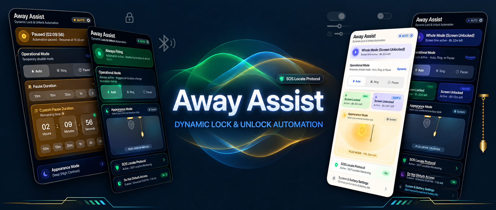

# Away Assist

<p align="center">
  <strong>Dynamic Lock & Unlock Ringer Automation for Android</strong>
</p>

<p align="center">
  
  
  
  
  
</p>

<p align="center">
  
</p>

---

## 🎯 The Story & Problem

Like many people, you probably prefer keeping your phone on **silent vibration** when actively using it—loud ringtones are disruptive when you are already looking at your screen. 

However, the moment you put your phone down on a desk, slip it into a pocket or backpack, or walk into another room, leaving it on vibrate means **constantly missing important calls from family, friends, or work**.

**Away Assist** solves this problem automatically and deterministically:
- 🔒 **Screen Locked (Phone Put Away)** → Sets ringer mode to **Normal Audible Ring**.
- 🔓 **Screen Unlocked (Phone in Hand)** → Automatically sets ringer mode back to **Vibrate**.

No manual toggling. No complex geofences. No battery drain.

---

## ✨ Key Features

- **Deterministic Hardware Automation**: Driven purely by system broadcast events (`ACTION_SCREEN_OFF` and `ACTION_USER_PRESENT`).
- **Zero Polling & 0% Idle Battery Drain**: No background alarms, no timers, and no battery loops. The app sleeps when idle and executes in fractions of a millisecond during screen transitions.
- **100% On-Device Privacy**: Contains **zero internet permission**, no analytics, no crash reporters, and no remote servers. Everything runs entirely on your device.
- **🚨 SOS Remote Locate & Anti-Theft**: Recover your lost device over SMS without internet access. High-accuracy GPS fixes (`FIND <PIN>`), continuous route tracing (`TRACE <PIN>`), remote audible alarm (`RING <PIN>`), and autonomous alerts on SIM card swap, device shutdown, or reboot.
- **⚡ 1-Tap Shizuku Privileged Controls**: Effortlessly grant `WRITE_SECURE_SETTINGS` on-device via Shizuku to automatically force-enable GPS and persistent Mobile Data on emergency commands.
- **Customizable Pause & Always Ring**: Pause automation for presets or custom durations, or select `Always Ring` to keep audible alerts continuously while keeping SOS security active.
- **Synced Home Screen Widget & Notification**: Control Auto mode, Force Ring, or trigger custom pause durations directly from your home screen widget or notification drawer.
- **Calm Indigo & Warm Vintage Theme**: High-end continuous squircle UI with interactive pull-cord vintage lamp toggle, gyroscope pendulum physics, and full-screen ambient lighting.
- **Ultra Lightweight**: Built with pure Kotlin & Jetpack Compose. Release APK size is only **~2.2 MB**.

---

## 📲 Download & Installation

### Option 1: Download from GitHub Releases
1. Go to the [Releases](https://github.com/LAVAN-N/away-assist/releases) page.
2. Download the latest `app-release.apk`.
3. Open the downloaded file on your Android device and tap **Install** (allow "Install unknown apps" for your browser/file manager if prompted).

### Option 2: Build from Source
```bash
git clone https://github.com/LAVAN-N/away-assist.git
cd away-assist
./gradlew assembleRelease
```
The compiled APK will be located at `app/build/outputs/apk/release/app-release.apk`.

---

## ⚙️ Initial Setup & Permissions

To ensure smooth and reliable background automation on all Android versions and OEM skins:

1. **Do Not Disturb Access (Notification Policy Access)**:
   - *Why it's required*: Android security policy mandates DND access for any application to programmatically modify system ringer modes between Audible and Vibrate.
   - *Setup*: Tap "Grant" inside the app or navigate to **Settings ➔ Apps & notifications ➔ Special app access ➔ Do Not Disturb access ➔ Away Assist (Allow)**.

2. **Battery Optimization (Exclude from Battery Saver)**:
   - *Why it's required*: Prevents aggressive OS power managers from delaying hardware screen broadcast listeners.
   - *Setup*: Tap "Set Unrestricted" in the app's settings section, or go to **App Info ➔ Battery ➔ Unrestricted**.

3. **Autostart & Recent Apps Pinning (Xiaomi / Samsung / Oppo / Vivo / OnePlus)**:
   - *Why it's required*: Protects the service from OEM task cleaners (*Cleaner*, *Device Care*, *Smart Manager*) when clearing recent apps.
   - *Setup*: Enable **Autostart** in your device security manager and lock Away Assist with the padlock icon in your Recent Apps overview.

---

## 🛠️ Tech Stack & Architecture

- **Language**: Kotlin
- **UI Toolkit**: Jetpack Compose (Material3 token base, hand-rolled continuous squircle design system)
- **State & Preferences**: Jetpack DataStore (Preferences)
- **Background Architecture**: Foreground Service (`RingerService`) + dynamic hardware `BroadcastReceiver` (`ScreenStateReceiver`)
- **Module Structure**: Single Gradle module (`app`)
- **Min SDK**: 26 (Android 8.0 Oreo) • **Target SDK**: 35 (Android 15)

---

## 🔒 Security & Privacy Architecture

Away-Assist is engineered with strict sandboxing and privacy-first principles:
- **No Internet Access**: The app requests `0%` internet permissions (`android.permission.INTERNET` is absent). No location data or telemetry ever leaves your phone over the web.
- **Permission Sandboxing**: Privileged permissions like `WRITE_SECURE_SETTINGS` (for auto-enabling GPS/Mobile Data during emergencies) are bound strictly to Away-Assist's Linux UID and cannot be accessed, shared, or exploited by other apps.
- **Salted SHA-256 PIN Verification**: Remote SMS commands (`FIND`, `TRACE`, `RING`, `MUTE`) require your personal PIN, validated entirely on-device.

👉 **Read the complete security model and threat analysis:** [`SECURITY_AND_PERMISSIONS.md`](SECURITY_AND_PERMISSIONS.md)

---

## 📦 Releases & Changelogs

- **[Latest Release v1.1.0 Notes](RELEASE_NOTES_v1.1.0.md)** — SOS Remote Locate, Anti-Theft Protection, Shizuku Integration & Always Ring Mode.
- **[Initial Release v1.0.0 Notes](RELEASE_NOTES_v1.0.0.md)** — Smart Lock/Unlock Automation, Widgets & Vintage Ambient Theme.

---

## 📄 License

Distributed under the **MIT License**. See [`LICENSE`](LICENSE) for more details.
